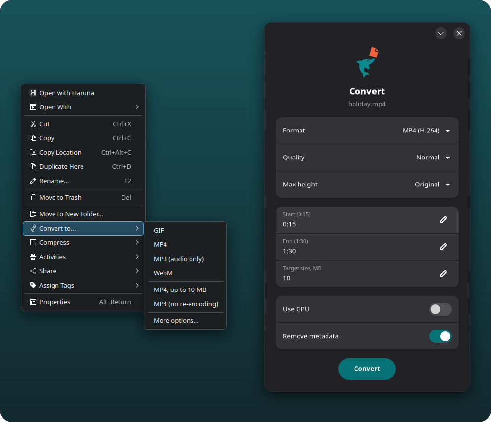

# dolphin-convert

Adds a **Convert to…** submenu to the Dolphin context menu for video, audio, images, PDF and office documents. Results are saved next to the originals, which are never modified or overwritten.



| Files | Formats |
| --- | --- |
| Video | MP4 (H.264, H.265, AV1), WebM (VP9), GIF, MP3, MP4 and MKV without re-encoding |
| Audio | MP3, M4A, Opus, OGG, FLAC, WAV |
| Images | JPG, PNG, WebP, AVIF, JXL, TIFF, GIF, BMP, ICO, PDF (one per image, or all images in one) |
| PDF | PNG and JPG (a folder if there are several pages), TXT |
| Documents | PDF, DOCX, ODT |
| Spreadsheets | PDF, XLSX, ODS, CSV (first sheet) |
| Presentations | PDF, PPTX, ODP |

Common conversions are one click away. **More options…** (video, audio, images) adds quality, and where it applies maximum height, trimming, a target file size, metadata removal and GPU encoding. Format, quality, height, metadata and GPU choices are remembered.

Available in English, Ukrainian, German, Spanish, French, Polish, Dutch and Catalan, following the system language.

## Requirements

- KDE Plasma 6 with Dolphin
- `ffmpeg` with libx264, libx265, libsvtav1, libaom, libvpx-vp9, libopus, libvorbis and libmp3lame
- Python 3 with PyGObject and libadwaita 1.6 or newer (`python3-gobject`, `libadwaita`) for the windows
- `kdialog`, `notify-send`
- ImageMagick 7 (`magick`) for images, Poppler (`pdftoppm`, `pdftotext`, `pdfunite`) for PDF
- LibreOffice (`soffice`) for office documents, optional; the Flatpak version is not supported

Stock Fedora ships a reduced ffmpeg. Enable [RPM Fusion](https://rpmfusion.org/Configuration) and install the full `ffmpeg` package from there.

## Install

```bash
git clone https://github.com/ekmryze21/dolphin-convert.git
cd dolphin-convert
./install.sh
```

The installer prints `Missing: …` for any tool it can't find. If the menu doesn't show up, restart Dolphin.

## Notes

- Trimming without re-encoding cuts at the nearest keyframe.
- GPU encoding (NVENC or VAAPI) applies to H.264 and H.265 and falls back to the CPU. A target size always uses the CPU.
- Animated images are converted as their first frame.
- Converting from AVIF drops transparency; converting to AVIF keeps it.

## Uninstall

```bash
./install.sh --uninstall
```

## Development

`./test.sh` runs real conversions in a temporary folder with stubbed dialogs. To add a language, copy a file in `lang/` and add its names to `menus/`.

## License

[MIT](LICENSE)
